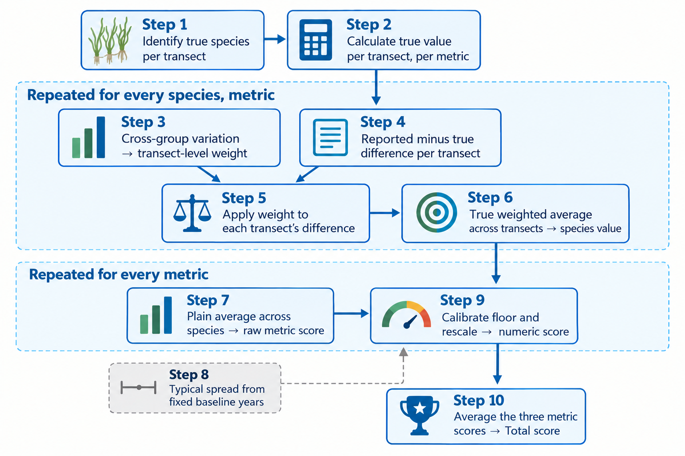

```{r}
#| results: hide
library(knitr)
library(flextable)
library(here)
library(dplyr)
library(tidyr)
library(english)

source(here('R/funcs.R'))

load(file = here('data/allyrscrs.RData'))
load(file = here('data/leaveoneoutcors.RData'))
load(file = here('data/calsens.RData'))
load(file = here('data/kendalltests.RData'))
load(file = here('data/slopedat.RData'))

load(file = here('tabs/trainsumtab.RData'))
load(file = here('tabs/modstab.RData'))
load(file = here('tabs/slopetab.RData'))
```

## Abstract {.unnumbered}

Text

*Key words*:



## Introduction 

Monitoring programs exist worldwide to support decision-making on the management of environmental resources.  These programs are developed to address specific questions, such as whether ambient conditions are satisfactory for designated uses, if trends in key parameters demonstrate progress in achieving ecosystem recovery goals, or if regional goals are being met as a collective effort across multiple entities [@nichols2006;@lindenmayer2010;@schiff2016]. In all cases, the quality of the data used to address the stated goals must be assessed to determine the accuracy and precision within the limits of the methods used for its collection [@oakley2003;@stribling2003]. These assessments can be done with formalized processes that incorporate strict quality control procedures and with the adoption of standardized operating procedures that ensure the methods being used are vetted by the larger resource management or regulatory communities. In cases when data do not satisfy quality control procedures or if undocumented methods are used, substantial time and effort is wasted often with limited resources [@legg2006;@nichols2006].  In severe cases, decisions based on flawed data can lead to undesirable outcomes [@friess2011]. Routine assessments of the accuracy and precision of monitoring data is therefore paramount to ensure their use leads to appropriate and informed decisions.

Monitoring data for marine angiosperms, or seagrasses, require particular scrutiny given their widespread use as indicators of overall ecosystem health and documented links with water quality [@dennison1993;@orth2006]. Assessments typically occur in different tiers that vary by spatial scale, level of information desired, and level of effort expended in data acquisition. The three tiers of seagrass monitoring include satellite or aerial based assessments of overall cover at the landscape scale, randomized baywide plot-based assessments of cover or abundance, and intensive high-resolution condition assessments at representative index sites [@neckles2012].  These tiers are similar to federally-established methods for wetlands in the US [@epa2002], thus the framework is relevant for monitoring biological resources in other environmental settings and the need for similar quality control procedures applies equally as well.  Ideally, all three tiers are utilized to provide complementary assessments of status and trends as multiples lines of evidence that describe the state of the resource.  However, given the tradeoffs inherent with each approach, the availability of all three tiers for a given location is the exception rather than the norm [@hossain2015].  Additionally, the quality control procedures that area applied to each tier vary substantially given the data format and methods used for their acquisition.  

Tampa Bay, Florida is a unique example where seagrasses have been used for decades as an endpoint to both assess and demonstrate long-term ecosystem recovery [@greening2011;@sherwood2017;@beck2024]. Seagrass data are available at the first and third tiers, where the former are produced approximately biennially as areal coverage maps from the Southwest Florida Water Management District (SWFWMD) and the latter is from extensive field surveys along fixed transects (both described at <https://tampabay.wateratlas.usf. edu/seagrass-monitoring/>).  Established quality control procedures for the SWFWMD are applied at different scales, including image acquisition during optimal flight windows that maximize image quality and ground-truth sampling for verification of digitized products. In contrast, the field-based transects are collected by multiple resource management agencies, each of which collect data at assigned transects that are surveyed each year [@tbep0816;@Beck20b]. Each agency follows the same established assessment procedures and the entry of field sheets into a shared database requires independent verification. Assessing the accuracy of the transect data is understandably more challenging than the tier 1 data, although an assumption is that these data are generally comparable across space and time such that their use to assess baywide condition is appropriate. An inter-agency training effort has been ongoing for several years, yet quantitative assessments of the comparability of the transect surveys among monitoring groups has not been rigorously conducted, nor is there an established quantitative approach for doing so. Improved confidence in these data would further support their use as an alternative line of evidence relative to the different tiers of monitoring data that are available.

Intercalibration efforts supported by robust training programs are a common remedy to improve the quality of field-based monitoring data [e.g., @mckenzie2000; @kosmala2016].  Unlike most water quality data that can be measured objectively with robust instrumentation or established laboratory practices, field-based human assessments are challenging even if established methods exist and it is commonly assumed that training activities in support of field monitoring are sufficient [@morrison2016; @feldman2018]. For example, the Braun-Blanquet approach is commonly used to assess seagrass species abundance [@braun1965; @bell2008].  This method defines ordinal abundance categories based on visual estimates of coverage in a gridded quadrat.  Disagreements among individuals can occur through numerous means, including inherent difficulties in determining ordinal scales instead of percent estimates [@dengler2023], missed species with low abundance that are obscured by more dominant ones [@milberg2008], or simply inherent variability in the subjectivity between different assessors [@reeves2007].  These differences can be assessed in part by evaluating pairwise agreement between two different estimates of the same location, although the efficacy of independent observations depends strongly on inter-specific differences and relative abundances [@milberg2008].  Further, these simple comparative approaches are not readily scalable across multiple groups (often consisting of multiple inviduals in the same group) nor across time (e.g., different survey years).  Therefore, routine intercalibration efforts should be supported by methods that allow unbiased and repeatable assessments of group performance over time.

This paper presents a scoring methodology to assess precision among different groups that participate in an annual field-based training program for seagrass assessment in Tampa Bay, Florida.  The primary objective is to present a reproducible and unbiased method to assess comparability among multiple groups that participate in the training each year.  The scores are communicated in a report card provided to each group that 1) incentivizes groups to improve assessment skillsets in species identification (seagrass and macroalgae) and enumeration of seagrass characteristics, and 2) allows comparability among groups to determine similarity of performance within years and if performance is changing over time. A primary hypothesis is that groups that have participated in the training for a majority of the seven years evaluated will show improved performance over time.  We also assess robustness of the method by evaluating key decision points and overall sensitivity to factors that influence the scores within and between years. A fundamental assumption is that there is no external ground-truth from which to compare group performance, such that agreement among groups (precision) was used as the basis for evaluation.  Although these methods and results have immediate relevance for regional monitoring of seagrass in Tampa Bay, the methods are open source and can be applied in other settings where practitioners desire information on the effectiveness of intercalibration training programs for field-based monitoring of natural resources.

## Methods

Prior to the transect monitoring that occurs each year in Tampa Bay, a one-day training event is conducted mid-June to further develop skillsets of field technicians and to assess comparability among the groups.  This training has been at the same location in Tampa Bay (in Lower Tampa Bay near the mouth, 27.649 N, 82.678 W) and has had consistent data reporting since 2020.  Additionally, most of the partners that participate in the interagency seagrass monitoring program have consistently attended each year, although it is noted that individuals from each entity have changed over time.

The training each year typically includes six locations chosen by the TBEP staff to represent a range of conditions (e.g., multi-species with dense cover, solitary species with low cover, etc.).  Each location is marked with a floating buoy attached to a 1 m$^2$ quadrat staked to the bottom.  Each group visits each location that is considered an independent unit for assessment.  For all locations, seagrass and macroalgal species are recorded using the Braun-Blanquet abundance scale [0 = no cover, 0.1 = solitary, 0.5 = few shoots, 1 = 1--5\% cover, 2 = 6--25\% cover, 3 = 26--50% cover, 4 = 51--75\% cover, 5 = 76--100% cover, @braun1965].  At three of the locations, blade lengths (cm) and short shoot densities (shoots m$^{-2}$) are also estimated for each seagrass species using three separate smaller quadrats (25 cm$^2$) placed in or near the larger quadrat. Additional ancillary information is also collected (e.g., epiphyte load, leaf condition, sediment type, etc.), although it is not considered for the scoring. Throughout this paper the training locations are referred to as transects, whereas the transects in the actual monitoring that occurs after training are true transects often extending hundreds of meters from the shoreline into the bay.

### Scoring

The scoring method was developed to compare consistency among groups that participated in the training each year, i.e., how closely a group's results compared to the overall group mean in a given year. The method also allows an assessment of scores over time to determine if groups are becoming more or less consistent with additional training. No single external ground truth exists, so precision was used as the basis of scoring.  Additionally, the species list for a given year was based on corraboration, not unanimity across groups, such that a species was considered present if at least two groups found it at a location. This allowed for the identification of both false positives and false negatives, both of which can penalize a group's score as described below.  

All scores were first calculated at the smallest scale of species/metric/location, then scaled up to a species/metric score, then finally summed to a metric score. Three scores are assigned to each group for the abundance, blade length, and short shoot density metrics. The total score is a simple average of the metric scores. The entire process to score an individual group in a given year includes ten steps, as shown in @fig-scoring_process and described in detail below.  All steps were developed using custom R functions [@rdct2025], relying heavily on the tidyverse suite of packages [@wickham2019].  

#### Step 1: Consensus Species List 

The first step requires identifying the consensus species that are present at each location.  As noted above, a species was considered present at a location if identified by at least two groups.  The species list could include both submerged aquatic vegetation (SAV or seagrass, typically *Halodule wrightii*, *Syringodium filiforme*, or *Thalassia testudinum*, hereafter referred to only by genus) or macroalgae (drift or attached, typically identified to genus).  By using corroboration as the basis for the species lists, species identified by only one group could be used to penalize a score as a false positive, whereas a species identified by at least two other groups but not another group also penalized the latter's score as a false negative.   

#### Step 2: True Values

The true values for the species metrics at each transect are then identified as the basis of comparison for each group in a given training year. In this step, the "true" values are simply the cross-group means of the metrics for each species at each location.  Although the averages are nominally true, they were not considered an absolute external ground truth since we acknowledge that no single group is perfect in their assessments.  The true values are calculated only for the consensus species at each location.  True values for abundance were estimated for all SAV and macroalgae species, whereas true values for blade length and short shoot density were calculated only for SAV since these values are not recorded for macroalgae. The abundance averages were based on the Braun-Blanquet values (0, 0.1, 0.5, 1, 2, 3, 4, or 5), which were snapped to the nearest value after averaging.  Blade length and short shoot density were averaged in their native units (cm and shoots  m$^{-2}$).

#### Steps 3-6: Group Differences and Species/Metric Scores

Steps 3-6 are repeated across species and metrics for a given group to combine results across each location.  Specifically, results are first evaluated at each location to identify the species and metric differences from the true values, then the location values are combined using a weighted average to obtain species and metric scores. Weighting is used to discount or penalize scores based on variation in the true values.  For example, differences from the true values are penalized more heavily for a group if all groups were more in agreement for a species and metric assessment, and vice versa.  Similarly, false positives and missed species (false negatives) are also penalized in the abundance scores when combining scores across locations.  The mechanics of these differences, their penalties, and species weighting is described in detail below. 

For these steps, differences in a group's reported values from the true values are calculated two ways.  For abundance and blade length, the difference $d$ for species $s$ at transect $t$ is a simple subtraction:

$$
d_{s,t} = \text{reported} - \text{true}
$$ {#eq-dst1}
For short shoot density, the difference is a symmetric percent difference:

$$
d_{s,t} = \frac{\text{reported} - \text{true}}{(\text{reported}+\text{true})/2}
$$ {#eq-dst2}

The symmetric percent difference was used for short shoot density because the magnitude of the difference varies with the magnitude of the raw measurements, which also varies by species (e.g., *Halodule* short shoot density is typically higher than *Thalassia*).  The symmetric percent difference removes this correlation by providing a common scale for assessing the differences.  Initial analyses also verified that blade length was not susceptible to this bias and @eq-dst1 was used for the differences.  

For abundance, the differences are in ordinal category positions for the Braun-Blanquet estimates (e.g., integer values from zero to eight for the values 0, 0.1, 0.5, 1, 2, 3, 4, and 5).  Using the ordinal category positions for the differences simply considers rank value differences since the actual abundance values differ between the categories, i.e., it was not desired to have different scales of comparison for low or high abundance estimates.  For a given group, the $d_{s,t}$ values for abundance are estimates for each species and transect using the consensus species list at that location.  If a group missed a species, it is assigned a zero, whereas a false positive is given a value of 1.  As such, a missed species is penalized proportionally based on the true ordinal position that scales with group consensus.  However, a false positive is only penalized by one ordinal category position since what category a group reports does not provide any information about whether the species was actually present.  False positives or missed species only influenced the abundance metric and not blade length or short shoot density calculations since these metrics cannot be meaningfully penalized in the same manner as abundance.

After the species- and transect-level differences are determined, the differences for each metric are then summarized for each species across the transects.  This summary used a weighted average where each species is assigned a weight based on the standard deviation of group estimates across the transects for each species.  The intent of using the weights was to discount or penalize differences for each group by considering how similar or different the groups were in their assessments.  Groups should not be penalized as heavily for large differences if all groups had variable estimates.  Similarly, groups should be penalized more for large differences if all groups had more similar estimates.  The species weights at each transect were determined as:

$$
w_{s,t} = \frac{1}{1 + \sigma_{s,t}}
$$ {#eq-weight}
$$
\sigma_{s,t} = \text{SD}\left(x_{s,t}\right)
$$ {#eq-weightsd}
where the weight $w$ for species $s$ at transect $t$ is simply the standard deviation $\text{SD}$ of estimates across all groups for that species at that transect ($x_{s,t}$).  One minor difference for the short shoot density metric is that the species, transect weights in [@eq-weightsd] are calculated using the coefficient of variation, following similar reasoning as using the symmetric difference in [@eq-dst2] described above. The weighted average for the species and metric that combines the differences across transects is then:

$$
\bar{d}_s = \frac{\sum_{t=1}^{T} w_{s,t}\,d_{s,t}}{\sum_{t=1}^{T} w_{s,t}}
$$ {#eq-weightave}
where a group's mean difference for a species $s$ across transects $t=1$ to $T$ is the summation of the weights $w_{s,t}$ multiplied by the differences $d_{s,t}$, then divided by the summation of the weights.  This equation applies to each metric and species.  

#### Step 7: Metric Scores

The next step is averaging the absolute differences across species to get the raw metric score:

$$
\text{metric score}_{\text{raw}} = \frac{1}{S}\sum_s |\bar{d}_s|
$$ {#eq-metscr}

where $S$ is the number of species each with $\bar{d}_s$. No further weighting is used since species weights are already included in $\bar{d}_s$. By the end of the process, there are three raw metric scores estimated for each group for abundance, blade length, and short shoot density. 

#### Steps 8-10: Final scores

The last steps convert the raw metric scores to a conventional numeric grading scale and letter grades.  At the simplest level, the distribution of the raw metric scores across the groups for a given metric score and year is rescaled from 50 to 100, with the group having the largest difference receiving 50 and the group having the smallest difference receiving 100. However, this simple rescaling does not account for variation in the scores among the groups across years.  Using the same scale each year may overly penalize years when groups were more similar.  To account for this, the minimum floor of the rescaling can be raised in years when groups were more similar, so that all groups receive an overall higher score.  The floor for a metric in a given year is calculated as:

$$
\text{floor}_{\text{yr, met}} = \max\!\left(50,\ 50 + \left(1 - \frac{\text{SD}_{\text{yr, met}}}{\overline{\text{SD}_{\text{met}}}}\right) \times 50\right)
$$ {#eq-flr}

where the floor is the maximum between 50 or a recalculated floor based on variation among groups for the metric scores in the focal year relative to baseline variation. The baseline variation was an estimation of "typical" score variation calculated as the mean of the standard deviation of raw scores across groups for the first five years of the training occurred ($\bar{\text{SD_{met}}}$). The number of years for the baseline period was subjective, although we demonstrate below how this choice influenced the floor behavior. The standard deviation of metric scores across groups for a focal year ($\text{SD_{yr, met}}$) was compared to the baseline variation as one minus the ratio of the two, multiplied by 50, then added to 50.  For example, if all groups had the exact same scores in a given year, the floor would be 100.  However, if the standard deviation of raw metric scores across groups in a focal year was greater than the baseline variation, the floor remained at 50, so that no extra penalty was applied.  In other words, the floor is only raised if within-year variation is less than the baseline. 

The three raw metric are assigned to a numeric score based on the ranges defined between the floor to 100 and then averaged to get a single total score for a group.  For communication to training participants, the numeric scores were converted to letter grades following a typical grading scheme, i.e., A = 100 -- 95, A- = <95 -- 90, B+ = <90 -- 85, $\dots$, D < 55.  

Each group that participated in an annual training received an online report card to both motivate and provide additional resources if improvements were warranted [@fig-reportcard].  These reports were parameterized as a Quarto dashboard that used a single template applied to each group and year.  The first tab of the report showed the group's scores for a year for each of the three metrics, the raw differences for the species used in each metric, the overall score, and a table showing individual transect outcomes relative to the group means. The second tab provided additional resources to consult if a group was deficient in any given area (i.e., species identification, large deviation for any of the metrics).  Any letter grades less than A- for the scores or any false positives or missed species prompted a conditional display of resources, otherwise, a satisfactory note was provided. The resources included online documentation and video training resources curated by the TBEP. 

### Sensitivity analysis

The scoring methods were evaluated to assess robustness to site or group changes over time and sensitivity to *a priori* decisions.  First, all scores were recalculated for each year after removing each location or group sequentially following a "leave-one-out" approach since the core of the method relies on averages across transects as group consensus.  The intent was to demonstrate that overall scores did not vary considerably based on inclusion or exclusion of individual sites or groups. The recalculated scores were compared to those using all sites or groups in a year with the expectation that results should be similar.  

Second, the choice for the number of years to use as the baseline comparison for the flooring method was also evaluated since this choice influences the range of scores that could be received each year. The score floors that were calculated each year for the three metrics were evaluated using the first two years to the first six years of training data (i.e., 2, 3, 4, 5, and 6 years of data were used to define the mean standard deviation of scores for each metric).  The expectation was the that the floors for each year and metric were relatively insensitive to the number of years used to define the baseline. 

### Assessment of scores over time

A primary goal of the trainings is to ensure consistent methods are used by the different groups that collect seagrass transect data in Tampa Bay. A reasonable expectation is that groups would improve their estimates over time as they participated in the trainings for successive years. To test this hypothesis, the change in the three metric scores and the change in the absolute values of the raw differences were evaluated over time using mixed-effects models, with group used as a random intercept for both.  The first model that evaluated the metric scores used the results of step 9 and the second model that evaluated the raw metric deviations used the results of step 7 (as absolute values) (@fig-scoring_process).  An expectation is that scores would increase and raw differences would decrease over time.  The metric scores were modeled with a linear mixed-effects model using the `lmer()` function from the lme4 R package [@bates15].  The raw metric deviations are non-negative, right-skewed, and have a variance that scales with their mean, so they were instead modeled with a generalized linear mixed model assuming a Gamma distribution (log link) using the `glmmTMB()` function from the glmmTMB R package [@brooks17].  A small continuity correction (half the smallest nonzero deviation for that metric) was added to raw metric deviations with a value of zero to allow use of the log-metric link function.  Additionally, a simple, one-tailed Kendall trend test [@kendall38] was applied to the standard deviations of the metric scores and raw absolute metric deviations to assess if variance was decreasing over time.

A final analysis was conducted to further identify any trends over time that may have been evident at the group, species, or metric level.  This analysis was done given that the above analyses at the metric-level may obscure trends that could vary by group or species.  For the final analysis, slopes of raw metric absolute deviations for the metrics and species results (step 6 in @fig-scoring_process) were calculated for each group to assess group-level changes given that trends may vary between groups.  This produced 63 slope estimates (3 metrics x 3 species x 7 groups), all of which had N = 7 for seven years. No p-values were evaluated since the small sample sizes and repeated measurements increases the potential for Type I errors and the results were interpreted only in a qualitative assessment. Additionally, only the three dominant SAV species were evaluated.

## Results

```{r}
# trainsumtab inline
grpyr <- allyrscrs |> 
  select(yr, grp) |> 
  distinct()
nassess <- nrow(grpyr)
grpcnts <- grpyr |> 
  summarise(
    cnt = n(), 
    .by = 'yr'
  )
avecnt <- grpcnts |>
  pull(cnt) |> 
  mean() |>
  round() |> 
  english() |> 
  as.character()
mincnt <- grpcnts |> 
  filter(cnt == min(cnt))
mincnt1 <- mincnt |> 
  pull(cnt) |> 
  unique() |> 
  english() |> 
  as.character()
mincnt2 <- mincnt |> 
  pull(yr) |> 
  paste(collapse = ', ')
maxcnt <- grpcnts |> 
  filter(cnt == max(cnt))
maxcnt1 <- maxcnt |> 
  pull(cnt) |> 
  unique() |> 
  english() |> 
  as.character()
maxcnt2 <- maxcnt |> 
  pull(yr) |> 
  paste(collapse = ', ')
yrcnts <- grpyr |> 
  summarise(
    cnt = n(), 
    .by = 'grp'
  )
whichsev <- yrcnts |> 
  filter(cnt == 7) |> 
  nrow() |> 
  english() |> 
  as.character()
whichsix <- yrcnts |> 
  filter(cnt ==6) |> 
  nrow() |> 
  english() |> 
  as.character()
nrem <- yrcnts |> 
  filter(cnt <= 3) |> 
  nrow() |> 
  english() |> 
  as.character()
nkep <- yrcnts |> 
  filter(cnt > 3) |> 
  nrow() |> 
  english() |> 
  as.character()
```

```{r}
# calibration floor sensitivity inline
calrngave <- calsens |> 
  summarise(
    dfv = diff(range(floor_adj)),
    .by = c(yr, metric)
  ) |> 
  pull(dfv) |> 
  mean() |> 
  round(1)
```

```{r}
# loo inline
crs <- leaveoneoutcors
crsmin <- crs |> 
  filter(corr == min(corr)) |> 
  pull(corr) |> 
  round(2)
crssit <- crs |> 
  filter(test == 'site') |> 
  pull(corr) |> 
  mean() |> 
  round(2)
crsgrp <- crs |> 
  filter(test == 'grp') |> 
  pull(corr) |> 
  mean() |> 
  round(2)
crsscr <- crs |> 
  filter(calc == 'scr') |> 
  pull(corr) |> 
  mean() |> 
  round(2)
crsdev <- crs |> 
  filter(calc == 'dev') |> 
  pull(corr) |> 
  mean() |> 
  round(2)
crsmet <- crs |> 
  summarise(
    corr = mean(corr), 
    .by = metric
  ) |> 
  filter(corr == max(corr)) |> 
  mutate(
    corr = round(corr, 2), 
    metric = tolower(metric)
  )
```

```{r}
# slopedat inline
tots <- slopedat |> 
  summarise(
   cnt = sum(slope < 0) / n()
  )
totsmet <- slopedat |> 
  summarise(
    cnt = sum(slope < 0) / n(), 
    .by = var
  )
totsmetspp <- slopedat |> 
  summarise(
    cnt = sum(slope < 0) / n(), 
    .by = c(var, Species)
  )
totsgrps <- slopedat |> 
  summarise(
    cnt = sum(slope < 0) / n(), 
    .by = grp_anon
  )
```

### Training summary and methods sensitivity

The methods described above were applied to every group that participated in the training from 2020 to 2026, producing `r nassess` total assessments (@tbl-trainsumtab). An average of `r avecnt` groups participated each year (minimum `r mincnt1` in `r mincnt2`, maximum `r maxcnt1` in `r maxcnt2`).  Only `r whichsev` groups participated all seven years, whereas `r whichsix` groups only missed one year of training.  All groups were used for the scoring process (i.e., to determine baseline variation and within-year species weights), whereas `r nrem` groups that participated in three or less years were removed from the assessment of scores over time.  Only groups that participated in the majority of years were included (n = `rnkep`) since they were most likely to benefit from repeated training and were expected to show a stronger signal in the trend models (see below).

For the metric scores across years, the minimum score was raised fourteen out of the 21 metric/year combinations (five years for abundance, four for blade length, and five years for short shoot density, @tbl-trainsumtab). The sensitivity analysis that evaluated different year groups to characterize the baseline (two to six years from 2020) also indicated that the choice for the number of years did not have a large influence on the score floor (@suppfig-calsens, floors on average differed by `r calrngave` across metrics, years, and year groups).  Years when groups performed more similarly (i.e., the floor was raised) were notable in 2021 for abundance (floor of 69), 2020 and 2026 for blade length (80 and 91, respectively), and 2020 and 2025 for short shoot density (70 and 75, respectively).  The minimum floor was at or closer to fifty for all other years.  Mean metric scores across groups were of course higher in years with raised minimum, scores, although high scoring years did not always correspond to higher floors (e.g., Blade Length mean score of 90 in 2021, floor at 50).

Species observed across all training years varied, although *Halodule*, *Syringodium*, and *Thalassia* were consistently observed at two or more transects each year (@tbl-trainsumtab).  *Halodule* was most common, occurring at four or more transects across the years, followed by *Thalassia* which also occurred at four or more transects except for 2023 (two transects), and finally *Syringodium* consistently occurring at two of the six transects each year.  *Ruppia maritima* was found at only one transect in 2023.  Macroalgae species were much less commonly observed, although this likely reflects an identification challenge rather than true abundance.  In particular, no macroalgae species were observed in the first two years, after which an effort was made by the TBEP to improve each team's ability to identify these species.  After 2021, macroalgae species were consistently identified, with *Ancanthophora sp.* being the most common.  

Analysis of how metric scores and raw metric deviations change with the exclusion of individual groups or sites across the years indicated both were sensitive to the effects of either (@fig-leaveoneout). This result is expected given that all training results are used to estimate the group consensus values, species weights, and baseline variation.  However, the intent was to assess the degree of sensitivity, such that inclusion or exclusion of any single group or transect should not substantially change the scores.  In all cases, the correlation across all years between the results after sequentially removing one site or one group compared to the full set was never below $\rho =$ `r crsmin` (raw metric deviations for short shoot density with site removal).  Metric scores and raw metric devations were generally more sensitive to individual sites ([@fig-leaveoneout]b, mean $\rho =$ `r crssit`) rather than groups ([@fig-leaveoneout]a, mean $\rho =$ `r crsgrp`), which is also an expected result since sites are generally chosen to represent variation in richness and abundance, whereas groups are all working to assess the same locations. Raw metric deviations were less sensitive to removal of individual sites or groups compared to metric scores (mean $\rho =$ `r crsmet`, `r crsscr`, respectively).  Finally, the `r crsmet$metric` metric was the least sensitive compared to the other metrics (mean $\rho =$ `r crsmet$corr`). 

### Trends

Metric scores and raw metric deviations did not exhibit visible trends over time, although substantial inter-annual variability was observed (@tbl-trainsumtab, @fig-scoredevtime). The lowest scores did not always track the largest absolute deviations, and vice versa, due to scaling applied to the metric scores with changes in the minimum absolute scores.  The lowest mean scores for abundance, blade length, and short shoot density were 2022, 2022, and 2021, respectively and the highest mean raw metric deviations were in 2023, 2024, and 2024, respectively.  Conversely, the highest mean scores for abundance, blade length, and short shoot density were in 2021, 2026, and 2020, respectively, and the lowest mean raw metric deviations were in 2021, 2026, and 2025, respectively.

Mixed-effects models evaluating trends in the metric scores and the raw metric deviations provided further support that trends were not evident (@suppfig-scrdevmods).  All six models (three for scores, three for deviations) showed no significant year effects (@tbl-modstab).  Slope magnitude and direction varied by model and metric, although no conclusions about the direction of the trends can be made since the uncertainty bounds included zero.  For the score models for each metric, although the year trends were not significant, the random group effects were much larger for the abundance metric model (shown by the group standard deviation and conditional R$^2$, @tbl-modstab), suggesting groups were less consistent in this metric over time compared to blade length and short shoot density (a singular fit). For the raw score deviation models, a similar pattern was evident although the models for blade length and short shoot density had singular fits for the group random effect (@tbl-modstab).  None of the Kendall trend tests that evaluated changes in the standard deviation of the scores or raw deviations for each metric over time were significant. 

Overall assessment of the slopes of individual group, metric, and species trends confirmed the model results above, with about half of all trends showing a decrease over time (i.e., an approximately even split for decreasing/improving trends, @tbl-slopetab).  Similarly, decreasing trends within metrics were also split with about half decreasing over time.  However, results by species within metrics revealed differing trends, such that *Thalassia* generally showed more improvements (decreasing raw metric deviations) than the other species, particularly for abundance and blade length (five of the seven groups had decreasing raw absolute deviations over time for each metric).  For the groups, five of the seven had more than half of the species/metric raw asolute deviations decreasing over time, whereas the remaining two had increasing deviations over time for all but two of the species/metric results.     

## Discussion

limitations
* truth is not known
* discounting abundance scores treats ordinal positions equally, although it's shown that independent observers are more likely to agree on measurements of high abundance compared to lower values, i.e., precision is lower for low abundance (see Jan's paper). Differences at higher abundnace categories could be weighted more. 

why didn't we see overall improvements over time - people from each group changing over time? I can quantify this....  good news is that scores were not declining.  we provide evidence that training is not detrimental, there is implicit value in a consolidated method to both inform and motivate.  Describe past efforts - one on one 

why raise the floor? what effect does this have on trend assessment? 

although the mixed-effects models showed no linear trends over time, information in the random effecs revealed sources of variation over time. 

what didn't work:

* attempts at discounting group differences by how variable they were between species.  this was done for a species across transects, small sample sizes (e.g., a species at two or three transects) made this measure noisy and not a meaningful assessment of group consistency.  Alternatively, the getween-group variation is a more meaningful measure of certainty, but it describes an entirely different source of variation. 

Value of reproducible method, parameterized reports. 



## Figures {.unnumbered}

{#fig-scoring_process}



{#fig-reportcard}



{#fig-scoredevtime}



![Comparison of raw deviations (rows 1 and 3) and scores (rows 2 and 4) for each of three metrics following a leave-one-out analysis for (a) sites and (b) groups across all years.  The values on the y-axis represent the newly calculated raw deviations or scores after removing one site or group for each of all sampling years, repeated until each site or group was removed once.  The x-axis shows the original full-sample value for comparison.  Points are colored by year.  The $r$ values represent the correlations between the recalculated values after removing one site/group and the full values with all sites/groups.  The dashed lines are 1:1 relationships.](figs/leaveoneout.png){#fig-leaveoneout}



## Tables {.unnumbered}

```{r}
#| label: tbl-trainsumtab
#| tbl-cap: "Summary of number of groups, metric scores, raw metric deviations, and consensus species lists for seven years of training.  Metric scores are averages across the groups with the minimum floor in parentheses (maximum was 100 for all instances).  Metric raw deviations are the averages of the absolute values with the minimum and maximum values across the groups in parentheses (abundance in ordinal categories, blade length in cm, and short shoot density as symmetric percent difference).  The species consensus lists show seagrass and macroalgae with numbers indicating the number of transects where a taxa was found. CYAN: cyanobacteria; DG: drift green; DR: drift red."
trainsumtab
```



```{r}
#| label: tbl-modstab
#| tbl-cap: "Model summaries of metric score and raw metric deviation trends over time (year) by metric, with group as a random intercept, restricted to groups with more than three years of participation. Metric scores were fit with a linear mixed-effects model (Gaussian). Raw metric deviations were fit with a generalized linear mixed model (Gamma, log link) and the Change yr⁻¹ and Group SD are on the log scale. AIC values are only comparable within the grouped rows. Units for the raw metric deviations (before log-transformation) are ordinal categories for abundance, cm for blade length, and symmetric percent difference for short shoot density. Group SD is the between group standard deviation. R² is shown for the marginal (fixed effects only) and conditional (fixed and random) effects. Short Shoot Density is a singular fit for the metric scores, and Blade Length and Short Shoot Density are singular fits for the raw metric deviations (group random-intercept variance estimated as zero), so their conditional R² is undefined. AIC: Akaike Information Criterion."
modstab
```



```{r}
#| label: tbl-slopetab
#| tbl-cap: "Slopes of change over time (year) for raw absolute deviations of metrics, by species and training group (identities anonymized as A-G; restricted to groups with more than three years of participation). Colors diverge at zero within each metric (red increasing, green decreasing), with the domain scaled separately per metric since the units differ (Abundance: category positions, Blade Length: cm, Short Shoot Density: percent difference)."
slopetab
```



## Data Availability {.unnumbered}

All data and analysis code for this manuscript is available on GitHub at <https://github.com/tbep-tech/seagrasstraining-manu>.

## Acknowledgments {.unnumbered}


## References {.unnumbered}

::: {#refs}
:::



## Supplementary Material {.unnumbered}

{#suppfig-calsens}



![Results of mixed-effects models comparing metric scores (top row) and raw metric deviations (absolute, bottom row) over time, restricted to groups with more than three years of participation.  Both models evaluate the results as a function of time with a random group effect.  A linear mixed-effects model (Gaussian) was used for the metric scores and a generalized linear mixed model (Gamma, log link) was used for the raw metric deviations.  Thick black lines show the overall group mean and thin dashed grey lines show individual group effects.  The bottom row's lines are curved because the underlying model is linear on the log scale rather than the response scale shown here.  Units for the raw metric deviations are ordinal categories for abundance, cm for blade length, and symmetric percent difference for short shoot density. The Short Shoot Density plot in the top row and the Blade Length and Short Shoot Density plots in the bottom row are singular fits, with the group random-intercept variance estimated as zero, so only the fixed-effect trend is shown.  None of the relationships are significant (ns: not significant).](figs/scrdevmods.png){#suppfig-scrdevmods}