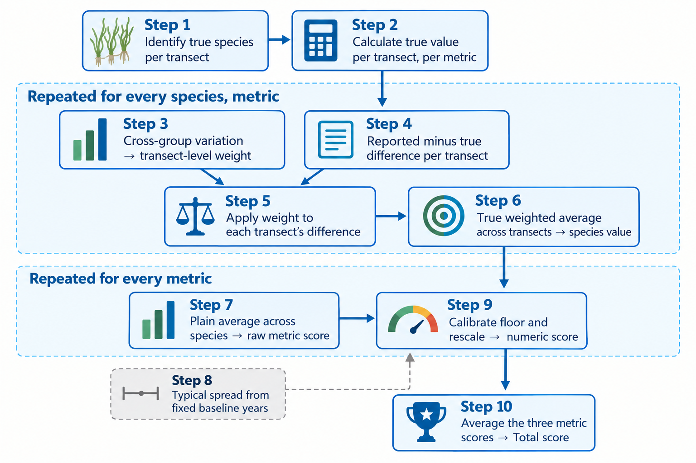

```{r}
#| results: hide
library(knitr)
library(flextable)
library(here)
library(dplyr)
library(tidyr)

source(here('R/funcs.R'))

load(file = here('tabs/scrmodstab.RData'))
load(file = here('tabs/spmodstab.RData'))
load(file = here('tabs/slopetab.RData'))
```

## Abstract {.unnumbered}

Text

*Key words*:



## Introduction 

importance of monitoring

local context

difficulty in precision/accuracy, examples with known biases

methods to assess precision/accuracy

goals: present a reproducible framework for assessing precision among disparate groups, evaluate its robustness (leave one out for 'truth', baseline sensitivity), and determine if training efforts have improved precision using the framework

## Methods

history of transect monitoring

note that we can't run trend analyses on converted scores - these are always rescaled each year, since the primary goal is to serve as a motivating example each year.  To assess trends, we really need to look at how avg raw differences have changed over time (see scratch.R). 

Sensitivity of the scoring method was evaluated two ways, the first assessing general sensitivity to the data used for the scoring and the second based on explicit decision for the year period used for defining the floor.  

## Results

robustness of method - year period for calibration of score floor, leave one out

group scores 

improving scores over time

## Discussion

limitations
* truth is not known
* discounting abundance scores treats ordinal positions equally, although it's shown that independent observers are more likely to agree on measurements of high abundance compared to lower values, i.e., precision is lower for low abundance (see Jan's paper). Differences at higher abundnace categories could be weighted more. 


what didn't work:

* attempts at discounting group differences by how variable they were between species.  this was done for a species across transects, small sample sizes (e.g., a species at two or three transects) made this measure noisy and not a meaningful assessment of group consistency.  Alternatively, the getween-group variation is a more meaningful measure of certainty, but it describes an entirely different source of variation. 




## Figures {.unnumbered}

{#fig-scoring_process}



![Comparison of raw deviations (top row) and scores (bottom row) for each of three metrics to actual estimates following a leave-one-site-out analysis across all years.  The values on the x-axis represent the newly calculated raw deviations or scores after removing one site for each of all sampling years, repeated until each site was removed once.  The $r$ values represent the correlations of the recalculated values after removing one site and the full values with all sites.  The dotted lines are 1:1 relationships.](figs/leaveoneout.png){#fig-leaveoneout}



{#fig-calsens}



![Results of mixed-effects models comparing group scores (top row) and absolute deviations (bottom row) over time.  The models in the top row evaluate scores as a function of time with a random group effect, whereas the models in the bottom row evaluate the absolute deviations of the group values from the between group means with random effects for species and group.  Solid lines show the overall group or group/species means and the dashed lines show individual effects for group or group/species.  The bottom right plot did not have significant species or group effects and only the fit of absolute deviation over time is shown.  None of the relationships are significant (ns: not significant).](figs/scrdevmods.png){#fig-scrdevmods}



## Tables {.unnumbered}

```{r}
#| label: tbl-scrmodstab
#| tbl-cap: "Model summaries of metric score trends over time (year) by metric, with group as a random intercept. Group SD is the between group standard deviation. R² is shown for the marginal (fixed effects only) and conditional (fixed and random) effects. AIC: Akaike Information Criterion."
scrmodstab
```



```{r}
#| label: tbl-spmodstab
#| tbl-cap: "Model summaries of absolute deviation trends over time (year) by metric, with species and group as crossed random intercepts. Units are specific to the metric (Abundance: category positions, Blade Length: cm, Short Shoot Density: percent difference).Group SD is the between group standard deviation and species SD is the between species standard deviation. R² is shown for the marginal (fixed effects only) and conditional (fixed and random) effects. Short Shoot Density is a singular fit (both random-intercept variances estimated as zero), so its conditional R² is undefined. AIC: Akaike Information Criterion."
spmodstab
```



```{r}
#| label: tbl-slopetab
#| tbl-cap: "Slopes of change over time (year) for raw absolute deviations of metrics, by species and training group (A-F). Colors diverge at zero within each metric (red increasing, green decreasing), with the domain scaled separately per metric since the units differ (Abundance: category positions, Blade Length: cm, Short Shoot Density: percent difference)."
slopetab
```



## Data Availability {.unnumbered}

All data and analysis code for this manuscript is available on GitHub at <https://github.com/tbep-tech/seagrasstraining-manu>.

## Acknowledgments {.unnumbered}


## References {.unnumbered}